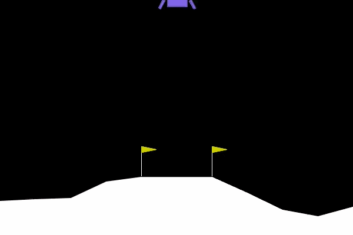

# START TREK (v0.1)



### Development

By *Ariel Amriou*(ariel.amriou@epitech.eu), *Pierrick Simon*(pierrick.simon@epitech.eu) & *Sacha Lemée*(sacha.lemee@epitech.eu).

## Objective

Train a Lunar Lander agent using Reinforcement Learning to autonomously land safely on the Moon (Gymnasium LunarLander-v3 environment).

- "You will program an algorithm that enables the module to correct its own trajectory. It will be a reinforcement-learning agent that learns by trial and error from sparse rewards" *(From [START TREK - EPITECH Subject](doc/G-AIA-401_start_trek.pdf))*

**Success criteria:** score > 200 over 100 consecutive episodes.

## Getting Started

### Prerequisites

This project requires the following dependencies:

- **Programming Language:** Python
- **Package Manager:** pip

## Requirements

- Python 3.x
- **Libraries:** Gymnasium, PyTorch
- **Physics engine:** Box2D (embedded in Gymnasium)

### Installation for Linux

1. **Clone the repository:**

```sh
git clone git@github.com:EpitechPGE2-2025/G-AIA-401-PAR-4-1-starttrek-16.git
```

2. **Navigate to the project directory:**

```sh
cd G-AIA-401-PAR-4-1-starttrek-16
```

3. **install dependencies:**

```sh
python3.12 -m venv .venv
source .venv/bin/activate
pip install -r requirements.txt
```

## Documentation

See [START TREK - Documentation](doc/DOCUMENTATION.md)

## License

This project is licensed under the **MIT License**.


